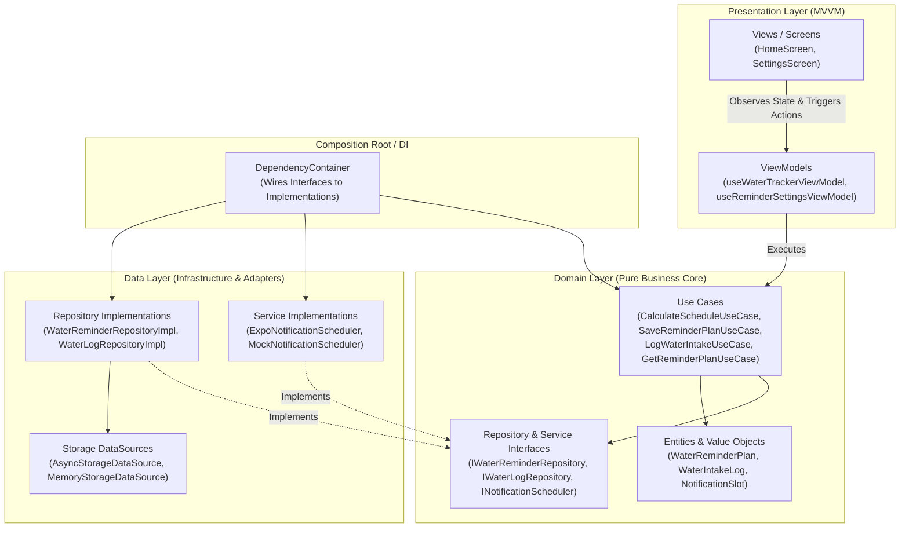
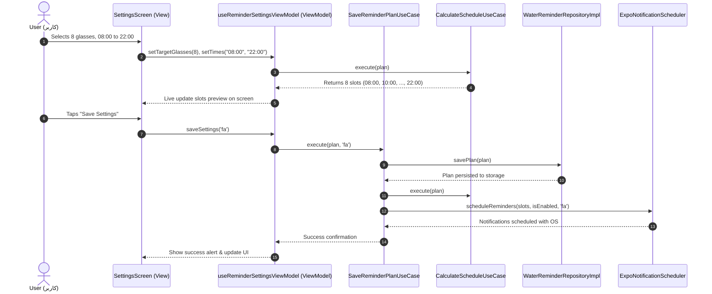

# 🏛️ Architecture Documentation (Clean Architecture + MVVM)

## 1. Architectural Layers & Separation of Concerns

---

## 2. Sequence Diagram: Configuring Reminders Flow

---

## 3. Directory Layout and File Responsibilities

| Path | Responsibility | Layer |
| :--- | :--- | :--- |
| `src/domain/entities/` | Enterprise rules, invariants, validation (`WaterReminderPlan`, `WaterIntakeLog`) | **Domain** |
| `src/domain/repositories/` | Pure abstract contracts (Interfaces) | **Domain** |
| `src/domain/usecases/` | Business action workflows (`CalculateScheduleUseCase`, etc.) | **Domain** |
| `src/data/datasources/` | Storage access abstractions (`AsyncStorageDataSource`, `MemoryStorageDataSource`) | **Data** |
| `src/data/services/` | Platform capabilities (`ExpoNotificationScheduler`, `MockNotificationScheduler`) | **Data** |
| `src/data/repositories/` | Concrete serialization & data mapping | **Data** |
| `src/presentation/di/` | Dependency Injection container (Composition Root) | **Presentation** |
| `src/presentation/viewmodels/`| UI state management hooks (MVVM ViewModel) | **Presentation** |
| `src/presentation/components/`| Reusable visual building blocks (Cups, progress meter, buttons) | **Presentation** |
| `src/presentation/screens/` | Top-level screen views (Home, Settings, Guide) | **Presentation** |
| `src/core/i18n/` | Bilingual dictionaries (`fa.ts`, `en.ts`) and RTL provider | **Core** |
| `src/tests/` | Unit, Integration, and BDD test suites | **Tests** |
